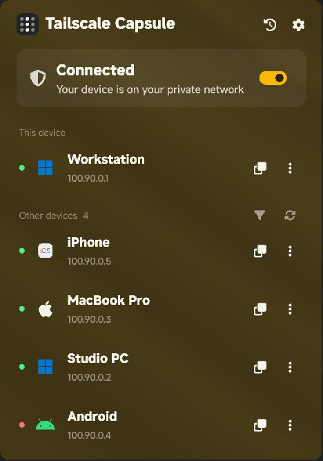
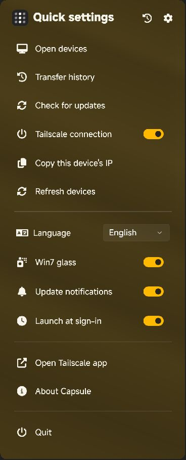
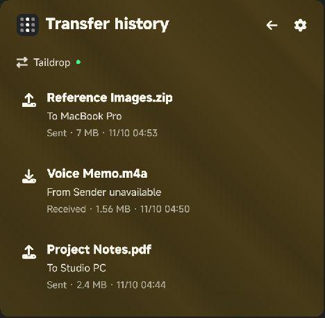

# Tailscale Capsule

[繁體中文](README.md) · [Latest release](https://github.com/aunight/tailscale-capsule/releases/latest)

Keep everyday Tailscale controls in the Windows notification area. A native WinUI 3 interface with Windows accent glass, a clear device list, and local Taildrop transfer history.



## Features

- **Tray controls**: left-click for devices, right-click for quick settings, and click outside to dismiss.
- **English and Traditional Chinese**: switch under Quick settings → Language. Capsule restarts to apply the language; active transfers defer the change until the next launch.
- **Windows accent glass**: follows accent changes automatically. Turn off “Win7 glass” for a solid dark surface.
- **Readable device list**: connection dots, platform icons, IP copying, and an online filter. Mac and iPhone have distinct icons.
- **Send with Taildrop**: select files from a device's menu and send using the official Tailscale CLI.
- **Send and receive history**: records names, direction, devices, sizes, progress, and results locally. Transfers started in Capsule can be cancelled.
- **Update notifications**: checks this repository's stable GitHub Releases. User-initiated installer downloads are verified against GitHub's SHA-256 digest before execution.
- **Native details**: MiSans TC typography, a blurred capsule copy notification, and fade transitions that respect Windows animation settings.

## Quick settings and history

| Quick settings | Transfer history |
| --- | --- |
|  |  |

All hostnames, addresses, and files shown in the screenshots are fictional examples.

## Install

1. Install and sign in to the [official Tailscale Windows client](https://tailscale.com/download/windows).
2. Download `TailscaleCapsule-2.1.2-Setup-x64.exe` from [Releases](https://github.com/aunight/tailscale-capsule/releases/latest).
3. Open Capsule from the notification area. A self-contained portable ZIP is also available; extract the full folder and run `TailscaleCapsule.exe`.

Windows 11 x64 is supported. Release packages include the .NET and Windows App SDK runtimes. MiSans TC is used when installed, with a system font fallback otherwise.

## History and update behavior

- History accumulates while Capsule is running. Ordinary downloads and transfers outside the monitoring period are not reconstructed as Taildrop history.
- If Tailscale does not provide the sender, the record says the source device is unavailable. Unconfirmed operations remain unconfirmed rather than being marked successful.
- Taildrop availability follows the official client's account, device, and network rules. The remote desktop action uses an installed Windows client or offers an official download page when none is present.
- Updates are not automatically downloaded or installed. Update notifications can be disabled in quick settings.
- Preferences, history, and diagnostic logs are stored under `%LOCALAPPDATA%\TailscaleCapsule`. History is saved in `transfers.json`.

## Build and checks

Use the .NET 10 SDK and Windows SDK. The build restores Windows App SDK NuGet packages.

```powershell
dotnet build TailscaleCapsule.csproj -c Release -p:Platform=x64
dotnet run --project tests/ServiceChecks.csproj -c Release -- --offline
```

Omit `--offline` on a machine with Tailscale installed to also check the local status and event subscription. These checks do not send files.

```powershell
.\Build.ps1 -InnoCompiler 'C:\Program Files (x86)\Inno Setup 6\ISCC.exe'
```

Outputs are written to `artifacts/release`. The build includes WinUI's required `.pri` resources and produces an installer, portable ZIP, and `SHA256SUMS.txt`.

Local status, the Taildrop event subscription, and automated checks have been verified. Full cross-device send/receive behavior has not yet been verified end to end.

## License

Source code is [MIT licensed](LICENSE). Fonts, icons, and runtime components retain their own licenses. Colored device icons are from [Icons8](https://icons8.com/icons); see [third-party notices](THIRD_PARTY_NOTICES.md).

This is an independent Tailscale interface and is not an official Tailscale product.
