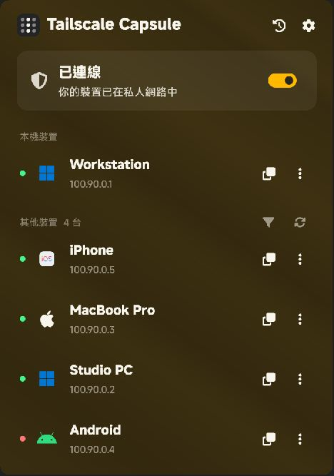
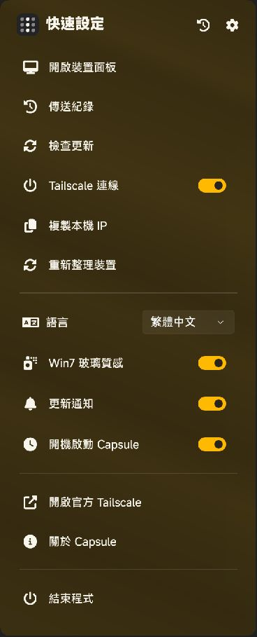
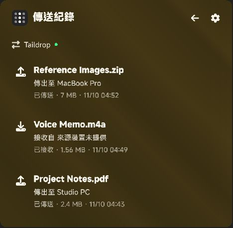

# Tailscale Capsule

[English](README.en.md) · [下載最新版本](https://github.com/aunight/tailscale-capsule/releases/latest)

讓 Tailscale 常用操作留在系統匣。原生 WinUI 3 介面，搭配跟隨 Windows 主題色的玻璃材質、裝置清單與 Taildrop 傳送紀錄。



## 功能

- **系統匣操作**：左鍵開啟裝置面板，右鍵開啟快速設定，點擊外部收起。
- **繁體中文／英文介面**：從快速設定的「語言 / Language」切換，重新啟動套用；傳送進行中會延至下次啟動。
- **Windows 主題色玻璃**：自動跟隨主題色變更；「Win7 玻璃質感」可切換成深色實底。
- **清楚的裝置清單**：狀態色點、平台圖示、IP 複製與線上篩選。Mac 與 iPhone 使用不同圖示。
- **Taildrop 傳送**：從裝置的三點選單選取檔案，使用官方 Tailscale CLI 傳送。
- **傳送／接收紀錄**：保存檔名、方向、裝置、大小、進度與結果，支援取消由 Capsule 發起的傳送。
- **更新通知**：定期檢查本儲存庫的穩定版 Release；手動啟動更新下載後，核對 GitHub 提供的 SHA-256，再執行安裝程式。
- **原生介面細節**：MiSans TC 字級層次、模糊膠囊複製提示與淡入淡出動畫；遵守 Windows 動畫設定。

## 快速設定與紀錄

| 快速設定 | 傳送紀錄 |
| --- | --- |
|  |  |

截圖中的主機名稱、IP 與檔案均為示範資料。

## 安裝

1. 安裝並登入 [官方 Tailscale Windows 用戶端](https://tailscale.com/download/windows)。
2. 到 [Releases](https://github.com/aunight/tailscale-capsule/releases/latest) 下載 `TailscaleCapsule-2.1.0-Setup-x64.exe`。
3. 安裝後從系統匣開啟 Capsule。也提供完整可攜式 ZIP，解壓後執行 `TailscaleCapsule.exe`。

支援 Windows 11 x64。Release 已包含 .NET 與 Windows App SDK 執行階段，不需另外安裝 .NET。MiSans TC 使用系統已安裝字體，未安裝時會使用系統替代字體。

## 紀錄與更新的範圍

- 紀錄自 Capsule 執行後累積，不會把一般下載或未監聽期間的檔案猜成 Taildrop 歷史。
- Tailscale 未提供接收來源時會標示「來源裝置未提供」；無法確認完成的項目會保留「狀態待確認」。
- Taildrop 可用性依官方 Tailscale 的帳號、裝置及網路設定而定。遠端桌面選項使用已安裝的 Windows 用戶端，缺少時提供取得用戶端的入口。
- 更新不會自動下載或安裝，可在快速設定關閉更新通知。
- 設定、紀錄與診斷日誌位於 `%LOCALAPPDATA%\TailscaleCapsule`，紀錄檔為 `transfers.json`。

## 開發與檢查

需要 .NET 10 SDK、Windows SDK。建置時會還原 Windows App SDK NuGet 套件。

```powershell
dotnet build TailscaleCapsule.csproj -c Release -p:Platform=x64
dotnet run --project tests/ServiceChecks.csproj -c Release -- --offline
```

有安裝 Tailscale 的電腦可省略 `--offline`，額外檢查本機狀態讀取及事件監聽。檢查不會自行傳送檔案。

```powershell
.\Build.ps1 -InnoCompiler 'C:\Program Files (x86)\Inno Setup 6\ISCC.exe'
```

產物位於 `artifacts/release`。建置會包含 WinUI 必要的 `.pri` 資源，並產生安裝包、可攜 ZIP 與 `SHA256SUMS.txt`。

本機狀態、Taildrop 事件監聽及自動化檢查已驗證；完整跨裝置傳送／接收尚未完成端到端驗證。

## 授權

原始碼採 [MIT](LICENSE)。圖示與執行階段依各自授權；彩色裝置圖示來自 [Icons8](https://icons8.com/icons)，詳見 [第三方聲明](THIRD_PARTY_NOTICES.md)。

這是獨立製作的 Tailscale 操作介面，並非 Tailscale 官方產品。
